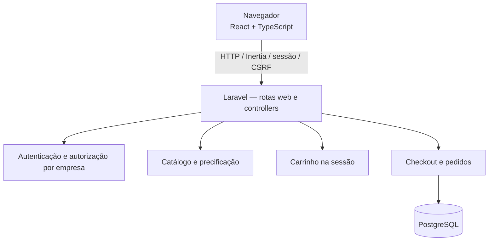

# Versotech B2B Commerce

MVP de e-commerce B2B construído com Laravel, React, TypeScript, Inertia.js e PostgreSQL. O fluxo disponível cobre login por empresa, catálogo e preços comerciais, carrinho de sessão, checkout e confirmação de pedidos.

## Requisitos locais

- Docker e Docker Compose em execução;
- Git;
- PHP/Composer para instalar dependências no host, ou ambiente PHP/Composer equivalente;
- Node.js e npm.

No Windows, use WSL2. Execute os comandos abaixo na raiz do repositório.

## Instalação e execução

```bash
cp .env.example .env
composer install
npm ci

./vendor/bin/sail up -d
./vendor/bin/sail artisan key:generate
./vendor/bin/sail artisan migrate --seed

npm run dev
```

Mantenha `npm run dev` em execução durante o desenvolvimento. Para servir assets compilados, execute `npm run build`. O endereço local usa `APP_PORT` (por padrão, `http://localhost`). Confira o serviço com `docker compose ps`.

Se Composer ou PHP não estiver disponível no host, instale as dependências em um contêiner PHP compatível antes de iniciar o Sail. Não é necessário instalar PostgreSQL no host. O primeiro acesso cria `.env`; use `APP_ENV=local` e nunca reutilize as credenciais demo fora do ambiente local.

## Contas de demonstração

O seeder `DemoUserSeeder` cria estas contas e define a senha `password` em ambiente não produtivo. A senha é apenas para demonstração local.

| Empresa | E-mail | Cenário |
| --- | --- | --- |
| Bom Preço | `bompreco@example.test` | Tabela PADRAO; empresa liberada e crédito disponível |
| Atacadão Central | `atacadao@example.test` | Tabela ATACADISTA; crédito disponível reduzido |
| Empório São Jorge | `emporio@example.test` | Empresa bloqueada: pode consultar, não confirmar pedidos |

Os seis arquivos de `data/` abastecem os seeders. A importação pode ser repetida sem duplicar cadastros e preserva estoque e crédito utilizado já existentes. Há 500 produtos, 3 empresas, 2 tabelas de preço, 972 preços associados, 3 promoções, 3 condições de pagamento e 3 contas demo.

## Roteiro da demonstração

Siga [`docs/demo/INC-06-demo.md`](docs/demo/INC-06-demo.md) para uma apresentação de cerca de 40 minutos, incluindo preços por empresa, atacado, bloqueio, crédito, estoque, pedido e limites conhecidos.

## Comandos úteis

```bash
# Aplicação e banco
./vendor/bin/sail up -d
./vendor/bin/sail artisan migrate --seed
./vendor/bin/sail artisan test

# Frontend
npm run typecheck
npm run build

# Encerrar serviços preservando volumes
./vendor/bin/sail down
```

Não use `migrate:fresh`, `db:wipe` ou `down -v` em um banco com dados a preservar.

## Regras e decisões principais

- A empresa e a tabela de preço vêm da identidade autenticada; o servidor recalcula valores, disponibilidade, crédito e elegibilidade.
- O preço unitário é o menor entre regular, atacado elegível por quantidade e promoção vigente calculada sobre o regular. Descontos não se acumulam.
- O carrinho fica na sessão e não reserva estoque nem crédito.
- A confirmação grava pedido, itens, estoque e crédito em uma transação; PIX não consome crédito e boletos consomem o total final.
- Valores monetários são inteiros em centavos. O checkout não processa pagamentos, emite boletos ou calcula frete.
- O MVP não usa imagens de produtos, Redis, filas, API REST pública ou serviços externos.
- A suíte automatizada padrão usa SQLite em memória e não cobre contenção concorrente com PostgreSQL (`lockForUpdate`). O desenvolvedor informou validação manual adicional com PostgreSQL no INC-06; detalhes estão registrados em [`INC-06`](docs/implementation/INC-06-polish-and-demo.md), enquanto [`INC-05`](docs/implementation/INC-05-checkout-and-orders.md) preserva o resultado da validação original daquele incremento.

## Documentação

- [Requisitos](docs/project/requirements.md)
- [System design](docs/architecture/system-design.md)
- [ADRs](docs/adr/README.md)
- [Incrementos e gates](docs/implementation/README.md)
- [Design e UX](docs/design/README.md)
- [Roteiro e checklist da demo](docs/demo/INC-06-demo.md)

## Estado da implementação

INC-01 a INC-06 estão registrados como implementados e aprovados. No INC-06, implementação, revisões, testes automatizados e critérios de UX/jornada foram concluídos. O commit manual do incremento ainda está pendente, conforme os gates descritos em [`docs/implementation/README.md`](docs/implementation/README.md).

---

## O problema e as prioridades do produto

O desafio não é apenas exibir produtos e aceitar um carrinho. Em uma operação B2B, duas empresas podem comprar o mesmo produto por preços diferentes, e a conclusão do pedido depende das condições comerciais associadas a cada empresa.

Os pontos centrais são:

- Cada usuário pertence a uma empresa e acessa a tabela de preços dessa empresa;
- O preço pode mudar por quantidade (atacado) ou promoção vigente;
- Nem todo produto tem preço em todas as tabelas;
- O pedido depende de estoque e, em compras a prazo, de crédito disponível;
- Condições de pagamento têm valores mínimos e podem aplicar acréscimos;
- Requisições repetidas ou simultâneas não podem duplicar pedidos, consumir crédito duas vezes ou deixar estoque negativo.

Por isso, tratei a confirmação do pedido como o caminho mais sensível do sistema. A interface deve facilitar a compra, mas o backend continua sendo a autoridade sobre preço, crédito e estoque. O enunciado original está disponível em [somosversotech/desafio-commerce-b2b](https://github.com/somosversotech/desafio-commerce-b2b).

O escopo foi dividido em incrementos para tornar cada parte revisável:

| Área | Escopo do MVP | Incremento |
| --- | --- | --- |
| Fundação e dados | Ambiente local, migrations, importação reproduzível e usuários demo | INC-01 |
| Identidade da empresa | Login, logout, sessão e isolamento por empresa | INC-02 |
| Catálogo e preços | Busca, filtros, paginação, detalhes e preços B2B | INC-03 |
| Carrinho | Adição, atualização e remoção na sessão | INC-04 |
| Checkout e pedidos | Condições de pagamento, crédito, estoque, transação e idempotência | INC-05 |
| Finalização | UX, documentação, integração e demonstração | INC-06 |

## Tecnologias e arquitetura

| Camada | Escolha | Motivo |
| --- | --- | --- |
| Backend | PHP e Laravel | Stack do desafio e convenções consolidadas |
| Frontend | React e TypeScript | Componentes tipados para as telas do MVP |
| Integração | Inertia.js | Páginas React junto às rotas e à autenticação web do Laravel |
| Assets | Vite | Desenvolvimento e compilação do frontend |
| Persistência | PostgreSQL | Integridade relacional e transações |
| Ambiente local | Laravel Sail / Docker Compose | Execução local reproduzível |
| Testes | Ferramentas de teste do Laravel | Verificação das regras e dos fluxos da aplicação |

As versões instaladas são determinadas pelos arquivos de dependências e seus lockfiles.

Optei por um monólito **Laravel com Inertia**, sem uma API REST separada para um frontend que faz parte da mesma aplicação:



O banco é a fonte persistente de verdade. O carrinho é temporário e não reserva estoque. No checkout, preços, disponibilidade e crédito são recalculados e validados no servidor. O [system design](docs/architecture/system-design.md) registra os componentes, o modelo de dados, fluxos e limitações conhecidas.

### Decisões que orientam a implementação

- **Preços:** usar o menor preço unitário elegível entre preço regular, atacado por quantidade e promoção vigente calculada sobre o preço regular. Descontos não se acumulam e produto sem preço na tabela da empresa não recebe fallback de outra tabela.
- **Dinheiro:** persistir valores em centavos inteiros (`BIGINT`, campos `*_cents`) e percentuais em decimal exato; aplicar arredondamento financeiro explícito.
- **Autenticação:** usar sessão web convencional do Laravel, CSRF e autorização pelo vínculo do usuário à empresa; sem Sanctum no MVP.
- **Pedido:** confirmar pedido, itens, baixa de estoque e eventual consumo de crédito em uma transação; usar chave idempotente para evitar duplicação em reenvios.
- **Produtos sem imagem:** os dados fornecidos não incluem imagens. O catálogo textual é intencional e deve funcionar também em telas menores.

## Estrutura do repositório

Visão dos diretórios principais e suas responsabilidades; arquivos e subpastas podem evoluir:

```text
.
├── app/                   # Backend Laravel: models, controllers e serviços
├── bootstrap/             # Inicialização do Laravel
├── config/                # Configurações
├── data/                  # JSONs de origem
├── database/              # Migrations, factories e seeders
├── docs/
│   ├── project/           # Contexto e requisitos
│   ├── architecture/      # Arquitetura e fluxos
│   ├── adr/               # Decisões arquiteturais
│   ├── design/            # Especificações de UI e UX
│   ├── implementation/    # Incrementos e gates
│   ├── workflows/         # Procedimentos de trabalho
│   └── demo/              # Roteiro de demonstração
├── resources/             # Telas e assets React/Inertia
├── routes/                # Rotas Laravel
├── tests/                 # Testes automatizados
├── .agents/skills/        # Skills do projeto
├── AGENTS.md              # Convenções e limites para agentes
└── README.md
```

## Testes e validação

Os testes priorizam regras cujo erro pode gerar pedidos incorretos ou comprometer dados comerciais: precificação, autorização por empresa, estoque, crédito, idempotência e rollback. O ambiente de referência para testes PHP é o Sail; executar PHP de teste diretamente no host pode usar extensões ou configurações diferentes.

Na validação formal do INC-01 foram registrados 15 testes aprovados e 50 asserções, importação dos seis JSONs sem referências órfãs, preservação de estoque e crédito ao reexecutar seeders, `npm run typecheck`, `npm run build` e resposta HTTP 200 da página inicial Inertia. Os demais incrementos registram suas evidências nos respectivos documentos.

Comandos usuais:

```bash
./vendor/bin/sail artisan test
npm run typecheck
npm run build
```

A suíte padrão usa SQLite em memória e não comprova contenção concorrente real no PostgreSQL. O desenvolvedor informou que executou uma validação manual adicional dessa concorrência durante o INC-06; os detalhes disponíveis constam no [registro do INC-06](docs/implementation/INC-06-polish-and-demo.md). A suíte automatizada e a validação manual são evidências distintas.

## Diretrizes de frontend

As decisões de frontend buscam usar React e TypeScript sem aumentar desnecessariamente a complexidade. A interface é organizada em componentes pequenos, com responsabilidades claras e props tipadas; a composição é preferida a grandes condicionais. O estado fica próximo de onde é usado, e hooks personalizados são reservados para lógica reutilizável. Efeitos e memoização devem responder a uma necessidade concreta.

CSS Modules mantêm estilos específicos próximos dos componentes, enquanto o CSS global fica restrito a reset, tipografia, tokens e fundamentos compartilhados. CSS Custom Properties permitem reutilizar tokens. A preferência por HTML semântico e CSS nativo evita bibliotecas de estilo sem necessidade demonstrável. A abordagem é responsiva, preservando uma experiência desktop cuidadosa e priorizando usabilidade em smartphone, foco visível e estados acessíveis. Os detalhes estão no [design system](docs/design/design-system.md) e nas [diretrizes frontend](docs/design/frontend-guidelines.md).

## Fora do escopo do MVP

Não fazem parte deste MVP: gateway de pagamento, emissão real de PIX ou boletos, frete, integração com ERP, painel administrativo, cadastro público de empresas, cancelamentos ou reembolsos, aplicação mobile nativa, API REST pública, autenticação federada, MFA, Redis, filas ou armazenamento/CDN de imagens. Essas capacidades não são necessárias para demonstrar a jornada de compra acordada.

## Uso de IA e processo de revisão

Utilizei **ChatGPT** e **Codex** como ferramentas de apoio à análise dos requisitos, documentação, discussão de trade-offs, planejamento, implementação, testes e revisão. As ferramentas apoiam o trabalho; decisões e validação continuam sob responsabilidade do desenvolvedor.

O processo busca não tratar uma resposta gerada como decisão automaticamente aprovada:

1. **Especificação:** definir requisitos, critérios de aceitação e decisões arquiteturais antes de solicitar implementação.
2. **Planejamento:** inspecionar o repositório e os dados e propor o escopo, arquivos e validações.
3. **Implementação:** trabalhar em incrementos delimitados e preparar testes pertinentes.
4. **Revisão adversarial:** uma revisão independente procura defeitos verificáveis e registra evidências, sem corrigir automaticamente.
5. **Revisão humana:** o desenvolvedor avalia achados, decide correções e revisa as mudanças.
6. **Validação formal:** executar testes e verificações após as revisões, registrar comandos e resultados e aguardar aprovação explícita. Commits são uma ação manual separada.

Um exemplo concreto foi a importação do INC-01: antes de escolher o mapeamento, foi necessário inspecionar os campos e identificadores dos JSONs. A decisão preservou os IDs de origem, converteu valores monetários com precisão e evitou que reimportações restaurassem estoque ou crédito operacional. Testes passando são evidência relevante, mas não substituem revisão de lógica nem decisão humana.

## Contexto reutilizável

O projeto usa desenvolvimento orientado a especificações (SDD) de forma leve. Cada documento tem um papel para que decisões possam ser encontradas, explicadas e revisadas:

| Artefato | Responsabilidade |
| --- | --- |
| [`AGENTS.md`](AGENTS.md) | Convenções gerais e limites para agentes |
| [`docs/project/`](docs/project/) | Problema e critérios de aceitação |
| [`docs/architecture/`](docs/architecture/) | Arquitetura e fluxos implementados |
| [`docs/adr/`](docs/adr/) | Decisões e consequências |
| [`docs/design/`](docs/design/) | Especificações de produto, UI e UX |
| [`docs/implementation/`](docs/implementation/) | Incrementos, critérios e gates |
| [`docs/workflows/`](docs/workflows/) | Procedimentos reutilizáveis |
| [`.agents/skills/`](.agents/skills/) | Skills de implementação e revisão |

## Plano de execução

O plano inicial cobria domingo, 15/11, a terça-feira, 17/11/2026. O resumo abaixo distingue entregas registradas de validações que ainda faltam no INC-06.

### Domingo — 15/11: fundamentos e dados

**Meta:** entender o desafio, estabelecer a arquitetura e criar uma fundação executável, sem avançar prematuramente para o checkout.

- [x] Ler o desafio e identificar regras funcionais e não funcionais.
- [x] Definir arquitetura Laravel + React + Inertia + PostgreSQL.
- [x] Documentar requisitos, system design e ADRs.
- [x] Organizar incrementos e workflow de revisão com IA.
- [x] Configurar Laravel Sail, frontend e banco de dados.
- [x] Criar migrations, importar os seis JSONs e criar usuários demo.
- [x] Revisar e validar tecnicamente o INC-01: 15 testes passaram, com 50 asserções; typecheck e build foram registrados como concluídos.

### Segunda-feira — 16/11: jornada de compra

**Meta:** implementar a maior parte do fluxo funcional, priorizando regras comerciais sobre refinamentos visuais.

- [x] INC-02: login, logout e autorização por empresa.
- [x] INC-03: catálogo, busca, detalhe, preços por empresa, atacado e promoções.
- [x] INC-04: carrinho em sessão, edição de quantidades e recálculo de preços.
- [x] INC-05: condições de pagamento, validação de estoque e crédito, confirmação transacional e idempotência.
- [x] Registrar revisões e validações dos incrementos anteriores nos documentos correspondentes.

### Terça-feira — 17/11: fechar o pedido e entregar

**Meta:** consolidar o caminho crítico e preparar a aplicação para ser executada e apresentada por alguém que acabou de receber o repositório.

- [x] Concluir a fase de implementação do INC-06: UX, documentação, roteiro e checklist de demonstração.
- [ ] Fazer revisão adversarial independente e tratar os achados conforme decisão do desenvolvedor.
- [x] Fazer revisão manual e executar a validação formal do INC-06, incluindo testes, typecheck/build e jornada ponta a ponta.
- [ ] Registrar resultados, limitações e aprovação do incremento.
- [ ] Realizar commit manual após aprovação.

O critério de entrega não é concluir toda melhoria imaginada, mas permitir demonstrar uma compra B2B correta e compreensível, do login à confirmação, explicando com clareza as limitações restantes.

## Priorização se faltar tempo

A ordem de proteção do escopo é:

1. **Aplicação executável:** iniciar Laravel, PostgreSQL e frontend de forma reproduzível.
2. **Fluxo essencial completo:** login → catálogo → carrinho → checkout → pedido.
3. **Corretude comercial e isolamento:** preço por empresa, elegibilidade dos pagamentos, estoque e crédito; sem permitir acesso indevido entre empresas.
4. **Integridade dos pedidos:** transação, rollback e prevenção de pedidos duplicados.
5. **Testes dos caminhos críticos:** sobretudo preço, autorização, checkout e reenvio.
6. **Erros e usabilidade essenciais:** mensagens claras, estados vazios e layout utilizável em desktop e celular.
7. **Polimento visual e extensões:** ajustes cosméticos e melhorias não exigidas.

Se fosse necessário reduzir o escopo, simplificaria primeiro a apresentação visual, filtros secundários e refinamentos. Não substituiria regras comerciais corretas por um checkout demonstrativo que grave dados inconsistentes. A documentação deve refletir o que foi implementado; itens incompletos permanecem como limitações, não como funcionalidades prontas.
