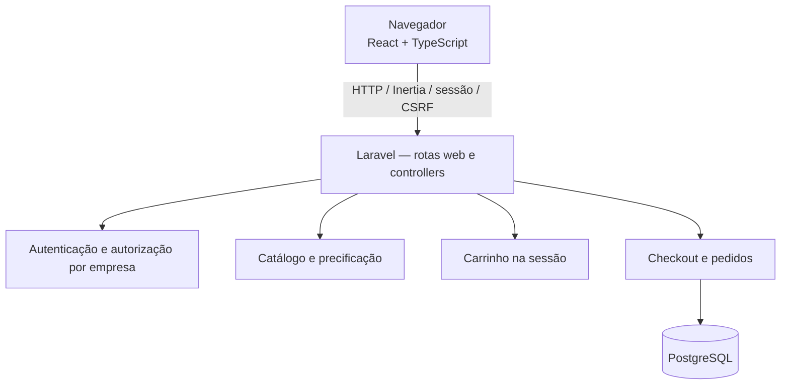

# Versotech B2B Commerce

Esse projeto é um app de e-commerce B2B.

Antes de implementar, procurei explicitar como entendi o problema e elaborar seu system design, quais regras podem comprometer uma compra e quais decisões cabem no prazo disponível. A prioridade é entregar uma **jornada de compra funcional e correta**, não acrescentar infraestrutura sem necessidade.

> **Estado em 16/11/2026:** O **INC-01 - Fundação e dados** foi implementado, revisado e validado tecnicamente. Os demais incrementos estão planejados ou em desenvolvimento. As funcionalidades descritas como _previstas_ abaixo não devem ser interpretadas como já entregues.

Documentação técnica: [System Design](/docs/architecture/system-design.md) ▪ [Requisitos](/docs//project/requirements.md) ▪ [ADRs](/docs/adr) ▪ [Plano incremental](/docs/implementation/README.md)

---

## Ambiente Local

O projeto utiliza Laravel Sail, baseado em Docker Compose, com PostgreSQL. O frontend React é entregue pelo Laravel por meio do Inertia.js.

Pré-requisitos

- Docker com Docker Compose, em funcionamento;
- Git;
- Composer para a instalação inicial das dependências PHP, ou um ambiente Docker equivalente para executar composer install;
- Node.js e npm para instalar e compilar os assets do frontend.
Os comandos abaixo partem da raiz do repositório. No Windows, a execução via WSL2 é recomendada.

## Instalação e inicialização

```bash
git clone <URL_DO_REPOSITORIO>
cd <NOME_DO_REPOSITORIO>

cp .env.example .env
composer install

./vendor/bin/sail up -d
./vendor/bin/sail artisan key:generate
./vendor/bin/sail artisan migrate
./vendor/bin/sail artisan db:seed

npm ci
npm run dev
```

`npm run dev` mantém o Vite executando para desenvolvimento; utilize outro terminal para os comandos do Sail. Se preferir não manter o Vite aberto, gere os assets de produção com `npm run build`.

A aplicação é servida pelo Laravel na porta configurada em `APP_PORT` (normalmente `http://localhost`, quando não alterada). Confira a porta efetiva com:

```bash
docker compose ps
```

### Produção com HTTPS

Configure `APP_ENV=production` e `SESSION_SECURE_COOKIE=true` no ambiente de produção. A configuração da aplicação habilita o atributo `Secure` por padrão quando `APP_ENV=production`; mantenha a variável explícita para tornar a exigência operacional visível. Esse cookie só deve ser usado quando a aplicação for acessada por HTTPS.

**Observação sobre a primeira instalação:** `./vendor/bin/sail` só existe após instalar as dependências do Composer. Se o Composer não estiver disponível no host, a instalação inicial precisará ser feita em um contêiner PHP/Composer compatível antes de iniciar o Sail. Não é necessário instalar PostgreSQL no host.

## Dados de demonstração

Os seis arquivos originais em [`data/`](data/) são importados pelos seeders:

|Conjunto|Registros|
|---|---|
|Empresas|3|
|Produtos|500|
|Estoques|500|
|Tabelas de preço|2|
|Preços por tabela|972|
|Promoções|3|
|Condições de pagamento|3|
|Usuários de demonstração|3|

A importação preserva os identificadores originais, não inventa os 28 preços ausentes da tabela atacadista e pode ser reexecutada sem duplicar registros. Estoque e crédito utilizado, por serem dados operacionais, não são restaurados por reimportações posteriores.

As contas de demonstração estão vinculadas às três empresas fornecidas, incluindo uma bloqueada. As credenciais efetivas devem ser conferidas nos seeders do repositório antes da apresentação; não documentar senhas ou dados que não correspondam à implementação.

## Comandos úteis

```bash
# Verificar os contêineres
docker compose ps

# Migrations e seeders
./vendor/bin/sail artisan migrate
./vendor/bin/sail artisan db:seed

# Testes PHP
./vendor/bin/sail artisan test

# Verificação e build do frontend
npm run typecheck
npm run build

# Encerrar os serviços (preservando volumes)
./vendor/bin/sail down
```

Não use `migrate:fresh`, `db:wipe` ou `down -v` em um banco com dados que precisem ser preservados.

---

## O problema

O desafio não é apenas exibir produtos e aceitar um carrinho. Em uma operação B2B, duas empresas podem comprar o mesmo produto por preços diferentes, e a conclusão do pedido depende de condições comerciais.

Os pontos centrais são:

- Cada usuário pertence a uma empresa e acessa sua própria tabela de preços;
- O preço pode mudar por quantidade (atacado) ou promoção vigente;
- Nem todo produto tem preço em todas as tabelas;
- O pedido depende de estoque e, em compras a prazo, de crédito disponível;
- Condições de pagamento têm mínimos e podem aplicar acréscimos;
- Requisições repetidas ou simultâneas não podem duplicar pedidos, consumir crédito duas vezes ou deixar estoque negativo.

Por isso, considero a confirmação do pedido o caminho mais sensível do sistema. A interface precisa facilitar a compra, mas a autoridade sobre preço, crédito e estoque permanece no backend.

O enunciado original está disponível em [somosversotech/desafio-commerce-b2b](https://github.com/somosversotech/desafio-commerce-b2b).

## Funcionalidades

|Área|Escopo previsto para o MVP|Incremento|
|--|--|--|
|Identificação da empresa|Login, logout, sessão e isolamento por empresa|INC-02|
|Catálogo|Home, busca, filtros, paginação e detalhes textuais|INC-03|
|Preços B2B|Tabela por empresa, preço de atacado e promoções|INC-03|
|Carrinho|Adição, atualização e remoção; armazenamento na sessão|INC-04|
|Checkout|Elegibilidade das condições de pagamento e resumo final|INC-05|
|Pedidos|Persistência, baixa de estoque, crédito, transação e idempotência|INC-05|
|Entrega|Tratamento de erros, UX, revisão geral e demonstração|INC-06|

**Entregue e validado até agora:** fundação Laravel/Inertia/React, PostgreSQL, migrations, seeders idempotentes, página Inertia inicial, três contas de demonstração e testes da importação (INC-01).

## Tecnologias

|Camada|Escolha|Motivo|
|---|---|---|
|Backend|PHP 8.4 + Laravel 13|Stack exigida pelo desafio e convenções consolidadas|
|Frontend|React 19 + TypeScript 5|Componentes reutilizáveis e tipagem|
|Integração|Inertia.js 2|Páginas React com rotas e autenticação web do Laravel|
|Assets|Vite 8|Desenvolvimento e build do frontend|
|Persistência|PostgreSQL 18|Integridade relacional e transações|
|Ambiente|Laravel Sail / Docker Compose|Execução local reproduzível|
|Testes|Ferramentas de teste do Laravel|Validação automatizada das regras e da importação|

Versões observadas na validação do INC-01: Laravel 13.42.0, PHP 8.4.27, PostgreSQL 18.7, React 19.3.1, Inertia React 2.3.29, TypeScript 5.9.3 e Vite 8.3.8. As versões efetivamente instaladas são determinadas pelos arquivos de lock.

---

## Arquitetura

Optei por um monólito **Laravel com Inertia**, evitando uma API REST separada para um frontend que faz parte da mesma aplicação.



O banco é a fonte persistente de verdade. O carrinho é um estado temporário e não reserva estoque. No checkout, preços, disponibilidade e crédito são recalculados e validados no servidor.

## Decisões que importam

**Preços:** para cada item, utilizar o menor preço unitário elegível entre o preço regular, o preço de atacado por quantidade e uma promoção vigente calculada sobre o regular. Descontos não se acumulam. Um produto sem preço na tabela da empresa não recebe preço de outra tabela.

**Dinheiro:** valores monetários são armazenados como inteiros em centavos (`BIGINT`, campos `*_cents`). Percentuais têm representação decimal exata; cálculos que geram frações de centavo seguem arredondamento explícito.

**Autenticação:** sessão web convencional do Laravel, com CSRF e autorização pelo vínculo do usuário à empresa; sem Sanctum no MVP.

**Pedido:** confirmação prevista em uma única transação, com bloqueio das linhas necessárias para proteger estoque e crédito. Chave de idempotência para evitar duplicação em reenvios.

**Produtos sem imagem:** os arquivos fornecidos não contêm imagens. O MVP usa um catálogo textual, com lista compacta e compra direta, inclusive em telas menores.

A discussão detalhada de componentes, requisitos funcionais e não funcionais, modelo de dados, fluxos de erro e trade-offs está em [`docs/architecture/system-design.md`](docs/architecture/system-design.md).

## Estrutura do repositório

Visão dos principais diretórios e responsabilidades; arquivos e subpastas podem evoluir entre os incrementos:

```text
.
├── app/                   # Backend Laravel: models, controllers e serviços
├── bootstrap/             # Inicialização do Laravel
├── config/                # Configurações
├── data/                  # Seis JSONs fornecidos no desafio
├── database/              # Migrations, factories e seeders
├── docs/
│   ├── project/           # Contexto e requisitos
│   ├── architecture/      # Arquitetura e fluxos
│   ├── adr/               # Decisões arquiteturais
│   ├── implementation/    # Especificação dos incrementos
│   └── workflows/         # Implementação, revisão e validação
├── resources/             # Telas e assets React/Inertia
├── routes/                # Rotas Laravel
├── tests/                 # Testes automatizados
├── .agents/skills/        # Skill reutilizável de revisão adversarial
├── AGENTS.md              # Convenções e instruções para agentes de IA
└── README.md
```

---

## Testes e validação

Os testes priorizam regras cujo erro pode produzir pedidos incorretos ou comprometer dados comerciais: precificação, autorização por empresa, estoque, crédito, idempotência e rollback.

Na validação formal do INC-01, foram registrados:

- 15 testes aprovados e 50 asserções, executados dentro do contêiner Sail;
- imports idempotentes dos seis JSONs e vínculos sem referências órfãs;
- preservação de estoque e crédito utilizado após reexecução dos seeders;
- npm run typecheck e npm run build concluídos;
- resposta HTTP 200 da página inicial Inertia.

```bash
./vendor/bin/sail artisan test
npm run typecheck
npm run build
```

A execução de `php artisan test` diretamente no host apresentou diferenças de ambiente (driver SQLite ausente e falha em teste Inertia). Por isso, o ambiente de referência para os testes PHP é o contêiner Sail.

Os testes de catálogo, precificação, carrinho, checkout e concorrência pertencem aos próximos incrementos. Não são apresentados como concluídos neste estágio.

---

## Diretrizes de frontend

As decisões de frontend buscam aproveitar os recursos atuais de React e TypeScript sem aumentar desnecessariamente a complexidade do projeto. A interface é organizada em componentes pequenos, com responsabilidades claras e props tipadas explicitamente. A composição é preferida a componentes com grandes condicionais; o estado fica próximo de onde é usado, e hooks personalizados são reservados para lógica reutilizável. Efeitos e memoização são adotados quando existe uma necessidade concreta, orientada por observação e medição.

Para estilos, CSS Modules mantêm as regras específicas próximas dos componentes, enquanto o CSS global fica restrito a reset, tipografia, tokens e fundamentos compartilhados. CSS Custom Properties permitem reutilizar tokens de cores, bordas, espaçamentos e tipografia. A preferência por HTML semântico e CSS nativo evita dependências de estilo mais amplas, como Tailwind, Bootstrap e bibliotecas CSS-in-JS. Componentes próprios atendem elementos simples; primitivas acessíveis, como Radix, podem ser consideradas quando uma interação mais complexa justificar essa dependência.

A abordagem é mobile-first, preservando uma experiência desktop cuidadosa e prioritária para o uso B2B. Estados interativos e foco visível fazem parte da experiência, com os detalhes definidos no [design system](docs/design/design-system.md) e nas [diretrizes frontend](docs/design/frontend-guidelines.md).

---

## Fora do escopo

Não pretendo implementar neste MVP gateway de pagamento, emissão real de PIX/boletos, frete, integração ERP, painel administrativo, cadastro público de empresas, cancelamentos ou reembolsos, aplicação mobile nativa, API REST pública, autenticação federada, MFA, Redis, filas ou armazenamento/CDN de imagens.

Essas capacidades podem fazer sentido numa evolução, mas não justificam atrasar a jornada de compra exigida no desafio.

---

## Uso de IA

Utilizei **ChatGPT** e **Codex** como ferramentas de apoio ao desenvolvimento, inclusive na análise dos requisitos, documentação, discussão de trade-offs, planejamento, implementação, geração de testes e revisão de código. O uso de IA é permitido e esperado pelo enunciado do desafio.

O processo foi organizado para não tratar uma resposta gerada como uma decisão automaticamente aprovada:

1. **Especificação:** defini requisitos, critérios de aceitação e decisões arquiteturais antes de solicitar código.
2. **Planejamento:** o Codex inspeciona o repositório e os dados e propõe um plano que reviso antes da implementação.
3. **Implementação:** o Codex implementa um incremento delimitado e escreve testes pertinentes.
4. **Revisão adversarial:** uma nova conversa, com uma skill do projeto, investiga possíveis defeitos e apresenta evidências, sem corrigir automaticamente.
5. **Revisão humana:** analiso os achados, aprovo ou rejeito correções e inspeciono o código.
6. **Validação formal:** executo ou supervisiono testes e build, verificando os resultados. O incremento só é encerrado depois do meu aval; os commits são manuais.

**Um exemplo concreto no INC-01 foi a importação:** o planejamento inicial não podia assumir os campos ou IDs dos JSONs sem inspecioná-los. Após a inspeção, definimos preservação de identificadores, conversão monetária exata e uma política de reimportação que não restaura estoque nem crédito operacional.

Os testes passando são evidência relevante, mas não substituem a revisão de lógica, a análise dos cenários de falha nem a responsabilidade humana pelas decisões.

## Contexto reutilizável

O projeto usa uma abordagem leve de desenvolvimento orientado a especificações (SDD) e reaproveitamento de contexto:

| Artefato | Responsabilidade |
| --- | --- |
| [`AGENTS.md`](AGENTS.md) | Convenções gerais e limites para agentes |
| [`docs/project/`](docs/project/) | Problema e critérios de aceitação |
| [`docs/architecture/`](docs/architecture/) | Arquitetura proposta e implementada |
| [`docs/adr/`](docs/adr/) | Decisões e consequências |
| [`docs/implementation/`](docs/implementation/) | Incrementos com escopo e critérios claros |
| [`docs/workflows/`](docs/workflows/) | Etapas de implementação e validação |
| `.agents/skills/adversarial-code-review/` | Procedimento reutilizável de revisão independente |

Não é a quantidade de documentos que importa, mas permitir que uma decisão seja encontrada, explicada e revisada.

---

## Plano de execução de 3 dias

Planejei o trabalho principal de domingo, 15/11, a terça-feira, 17/11/2026. O plano define prioridades e resultados esperados; os itens ainda não verificados permanecem em aberto.

### Domingo — 15/11: fundamentos e dados

**Meta:** compreender o desafio, estabelecer a arquitetura e ter a fundação executável, sem avançar prematuramente para o checkout.

- [x] Ler o desafio e identificar regras funcionais e não funcionais.
- [x] Definir arquitetura Laravel + React + Inertia + PostgreSQL.
- [x] Documentar requisitos, System Design e ADRs.
- [x] Organizar incrementos e workflow de revisão com IA.
- [x] Configurar Laravel Sail, frontend e banco de dados.
- [x] Criar migrations e importar os seis JSONs.
- [x] Criar usuários de demonstração vinculados às empresas.
- [x] Revisar código e validar o INC-01.
O resultado verificável foi a fundação funcionando, com importação reproduzível, 15 testes aprovados e build do frontend concluído.

### Segunda-feira — 16/11: jornada de compra

**Meta:** implementar a maior parte do fluxo funcional, priorizando regras de negócio sobre refinamentos visuais.

- [x] INC-02: login, logout e autorização por empresa.
- [x] INC-03: catálogo, busca, detalhe, preços por empresa, atacado e promoções.
- [x] INC-04: carrinho em sessão, edição de quantidades e recálculo de preços.
- [ ] Iniciar INC-05: condições de pagamento, validação de estoque e crédito.
- [ ] Aplicar revisão adversarial e revisão manual aos incrementos concluídos.
- [ ] Executar os testes pertinentes e registrar as limitações.
Resultado esperado: usuário entra na empresa correta, navega pelo catálogo, vê preços comerciais corretos e prepara um pedido.

### Terça-feira — 17/11: fechar o pedido e entregar

**Meta:** concluir o caminho crítico e validar a aplicação como alguém que acabou de receber o repositório.

- [ ] Finalizar INC-05: confirmação transacional, baixa de estoque, crédito e idempotência.
- [ ] Finalizar INC-06: estados de erro, usabilidade e ajustes essenciais de responsividade.
- [ ] Executar suíte de testes, typecheck e build.
- [ ] Validar ao menos um fluxo de compra ponta a ponta, incluindo rejeições esperadas.
- [ ] Revisar documentação, variáveis de ambiente e instruções de instalação.
- [ ] Conferir histórico de commits e ausência de segredos.
- [ ] Preparar demonstração e justificativas das decisões técnicas.

O critério de entrega não é concluir toda melhoria imaginada, mas permitir demonstrar uma compra B2B correta e compreensível, do login à confirmação do pedido.

## Priorização se faltar tempo

A ordem de proteção do escopo é:

1. **Aplicação executável:** iniciar Laravel, PostgreSQL e frontend de forma reproduzível.
2. **Fluxo essencial completo:** login → catálogo → carrinho → checkout → pedido.
3. **Corretude comercial e isolamento:** preço por empresa, elegibilidade dos pagamentos, estoque e crédito; sem permitir acesso indevido entre empresas.
4. **Integridade dos pedidos:** transação, rollback e prevenção de pedidos duplicados.
5. **Testes dos caminhos críticos:** sobretudo preço, autorização, checkout e reenvio.
6. **Erros e usabilidade essenciais:** mensagens claras, estados vazios, layout utilizável em desktop e celular.
7. **Polimento visual e extensões:** ajustes cosméticos e melhorias não exigidas.

Se for necessário reduzir o escopo, vou simplificar primeiro a apresentação visual, filtros secundários e refinamentos. Não considero aceitável substituir regras comerciais corretas por um checkout apenas demonstrativo que grave dados inconsistentes.

A documentação deve refletir o que realmente foi implementado. Itens incompletos serão apresentados como limitações, não como funcionalidades prontas.
