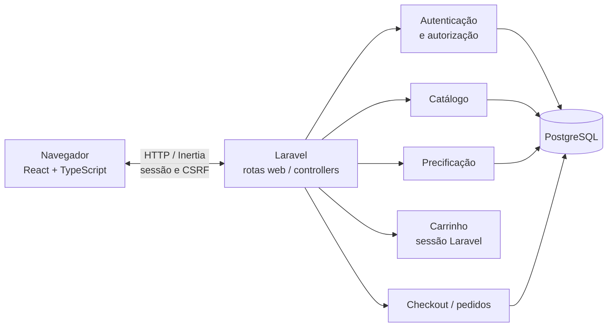
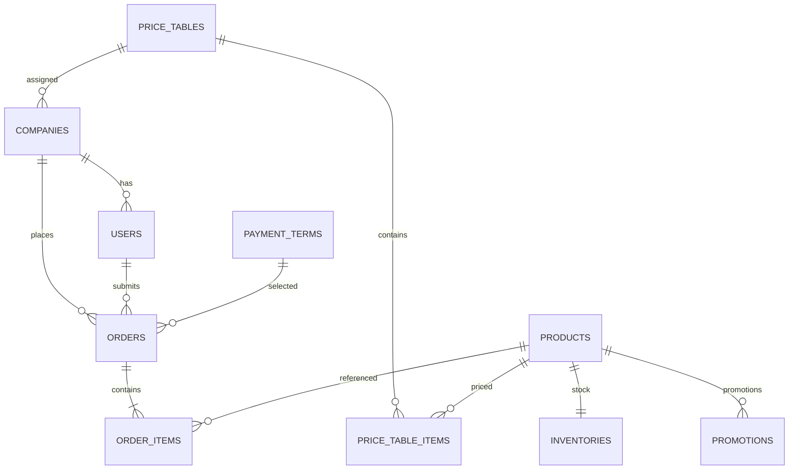
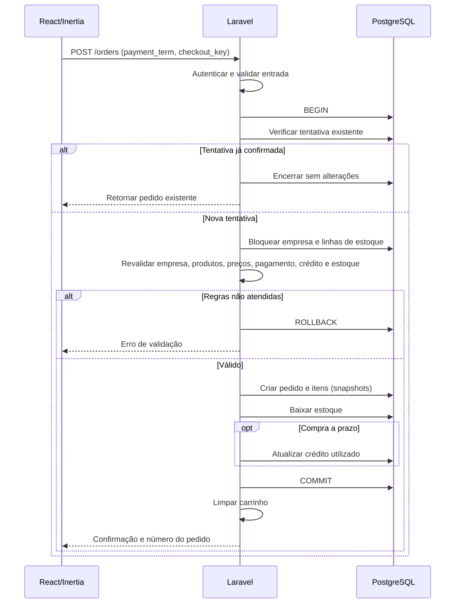

# System Design — Versotech B2B Commerce

**Status:** Implementação parcial — INC-04 em revisão adversarial
**Atualizado em:** 15/11/2026
**Requisitos:** [requirements.md](../project/requirements.md)
**Decisões:** [ADRs](../adr/)

> Este documento descreve a arquitetura proposta. À medida que o código for implementado, atualizar componentes, modelo de dados e fluxos para refletir o comportamento **efetivamente entregue**. Não apresentar decisões propostas como já implementadas.

## 1. Objetivo e limites

Implementar um e-commerce B2B com login por empresa, catálogo, preços específicos, carrinho, checkout e emissão de pedidos. A integridade de estoque e crédito é prioridade.

**Stack:** Laravel (PHP), React + TypeScript + Vite, Inertia.js, PostgreSQL e Laravel Sail (Docker Compose).

**Não fazem parte do MVP:** API REST pública, Sanctum, Redis, filas, integrações de pagamento, ERP, cálculo de frete, painel administrativo e imagens de produtos.

## 2. Visão de componentes

- Inertia entrega páginas React a partir das rotas web Laravel; não é necessária uma API REST separada para esse frontend.
- Backend é a única fonte de verdade para empresa, preço, estoque, crédito e total.
- Serviços de domínio devem encapsular cálculos comerciais e confirmação de pedidos; evitar camadas genéricas sem necessidade.
- A sessão armazena identificadores de produto e quantidades do carrinho, **não** preços autoritativos.

## 3. Modelo de dados proposto

| Entidade | Campos relevantes |
| --- | --- |
| `companies` | id (preservado da origem), tax_id, legal_name, trade_name, city, state, price_table_id, credit_limit_cents, credit_used_cents, is_blocked, block_reason nullable |
| `users` | id, company_id, name, email, password (hash gerenciado pelo Laravel) |
| `products` | id (preservado da origem), sku, ean, name, description nullable, brand, category, is_active |
| `inventories` | id BIGINT PK autoincrementável, product_id BIGINT FK único, quantity; uma linha de estoque por produto |
| `price_tables` | code (chave primária textual), description |
| `price_table_items` | price_table_id, product_id, regular_price_cents, wholesale_price_cents nullable, wholesale_min_qty nullable |
| `promotions` | id (preservado da origem), product_id, discount_percent (`NUMERIC(7,4)`), starts_on, ends_on |
| `payment_terms` | code (chave primária textual), description, minimum_amount_cents, surcharge_percent (`NUMERIC(7,4)`), is_credit |
| `orders` | id, company_id, user_id, payment_term_id, checkout_key único, status, subtotal_cents, surcharge_cents, total_cents |
| `order_items` | order_id, product_id, sku_snapshot, name_snapshot, quantity, unit_price_cents, line_total_cents |

**Integridade:** chave única para `(price_table_id, product_id)`; estoque não negativo; quantidades positivas; chaves estrangeiras; índices de busca e associação. Todos os valores monetários são inteiros em centavos (`BIGINT` no PostgreSQL). A estrutura exata das migrations pode ajustar nomes sem alterar as regras.

### Convenções de nomenclatura e dinheiro

- Identificadores técnicos **sempre em inglês**: tabelas/colunas em `snake_case`, classes PHP em `PascalCase`, variáveis e métodos PHP/TypeScript em `camelCase`, componentes React em `PascalCase`.
- Seguir convenções do Laravel (`users.password`, `created_at`, `updated_at`, `company_id` etc.).
- Conteúdo de negócio fornecido nos JSONs e textos da interface podem permanecer em português; o importador mapeia chaves de origem para colunas em inglês.
- Todo campo de valor monetário deve terminar com `_cents` e armazenar **inteiro em centavos**: `regular_price_cents`, `credit_limit_cents`, `subtotal_cents`, `surcharge_cents`, `total_cents`.
- Exemplo: R$ 19,90 → `1990`; R$ 1.500,00 → `150000`.
- Percentuais **não são dinheiro**: armazenar como `NUMERIC(7,4)` (por exemplo, `2.5000` representa 2,5%). Nunca usar `float` para calcular preços ou acréscimos; usar aritmética inteira com escala definida ou decimal exato (ex.: BCMath) e arredondamento explícito para centavos.
- Definir arredondamento **half-up** para valores não negativos: preço unitário promocional arredondado para centavos antes de multiplicar pela quantidade; acréscimo do pagamento calculado sobre o subtotal e arredondado uma vez para centavos. Não arredondar repetidamente no frontend.
- Ao importar números decimais dos JSONs, converter de forma exata para centavos (preferir representação textual/decimal, sem multiplicação por `float`).

**Dados de entrada:** importar os seis JSONs de `data/` por seeders reproduzíveis. Preservar os IDs originais de empresas, produtos e promoções; após inserir IDs explícitos, sincronizar as sequências PostgreSQL correspondentes. Para estoque, mapear `produto_id` da origem para `inventories.product_id`; `inventories.id` é gerado pelo banco. Converter os números JSON para strings decimais antes da conversão de dinheiro para centavos, rejeitando frações de centavo em vez de arredondá-las na importação. Na reexecução, atualizar campos originados dos JSONs sem restaurar `inventories.quantity` nem `companies.credit_used_cents` já existentes. Criar três usuários de demonstração vinculados às três empresas. O conjunto de dados não contém imagens ou URLs de imagens.

## 4. Autenticação e isolamento

- Login e logout com autenticação web convencional do Laravel; sessão, cookies e CSRF, **sem Sanctum**.
- Proteger rotas e aplicar limitação de tentativas de login; regenerar sessão após autenticação e invalidá-la no logout.
- A empresa é sempre derivada do usuário autenticado, nunca de um `company_id` enviado pelo cliente.
- Restringir acesso a pedidos e dados comerciais à empresa autenticada.
- Empresa bloqueada pode navegar, mas não finalizar compras.
- Evitar vazamento de carrinho entre contas: limpar/invalidar carrinho ao mudar de identidade.

**Trade-off:** uma API não é necessária para escalar horizontalmente o monólito. Uma API versionada pode ser adicionada no próprio Laravel se surgirem consumidores externos ou mobile. Sessões compartilhadas serão necessárias em ambiente com múltiplas instâncias. Ver [ADR-004](../adr/004-web-auth-without-sanctum.md) e [ADR-005](../adr/005-auth-security-scope.md).

## 5. Catálogo e precificação

### Catálogo

- Home e catálogo textual, sem imagens.
- Busca por nome, SKU ou EAN, filtro por categoria e paginação.
- Produtos inativos não são comercializáveis.
- Produto sem preço na tabela da empresa não pode ser comprado.
- Produto sem estoque pode ser exibido como indisponível, mas não pode ser adicionado ao carrinho.

### Cálculo do preço unitário

Entradas: empresa, produto, quantidade e data de referência.

1. Carregar preço regular da tabela associada à empresa.
2. Tornar elegível o preço de atacado quando `quantity >= wholesale_min_qty`.
3. Tornar elegível o preço promocional quando a promoção estiver vigente (datas inicial e final inclusivas), calculado **sobre o preço regular**.
4. Selecionar o **menor preço unitário elegível**; descontos não são acumulados.
5. Calcular o preço unitário promocional em centavos com arredondamento half-up; selecionar o menor preço unitário elegível em centavos e multiplicar pela quantidade para obter `line_total_cents`.

Regras:

- Sem fallback para outra tabela de preço.
- Promoções expiradas ou futuras não participam do cálculo.
- Se houver promoções simultâneas, escolher o menor preço elegível.
- Usar fuso horário configurado explicitamente (proposta: `America/Sao_Paulo`).
- Backend recalcula valores em todas as etapas relevantes, especialmente na confirmação; frontend apenas formata centavos para exibição em BRL.

## 6. Carrinho e checkout

**Carrinho:** sessão Laravel, com itens identificados por produto e quantidade. Adicionar, atualizar e remover. Não reservar estoque nem consumir crédito. Os preços exibidos são recalculados a partir do banco.

**Condições de pagamento:**

| Código | Elegibilidade | Acréscimo | Crédito |
| --- | --- | --- | --- |
| `PIX` | Subtotal positivo | 0% | Não |
| `BOL28` | Subtotal ≥ R$ 300,00 | 0% | Sim |
| `BOL2856` | Subtotal ≥ R$ 1.000,00 | 2,5% | Sim |

Os mínimos são avaliados sobre o subtotal **antes** do acréscimo. O total do pedido (`total_cents`) inclui `surcharge_cents`, calculado sobre `subtotal_cents` com arredondamento half-up. Compras a prazo consomem o **total final em centavos** do limite de crédito. Compras PIX não consomem crédito.

`available_credit_cents = credit_limit_cents - credit_used_cents`.

**Exemplos de dados:** Bom Preço dispõe de R$ 11.800; Atacadão Central, R$ 1.500; Empório São Jorge está bloqueado.

## 7. Confirmação de pedido: transação, concorrência e idempotência

### Garantias

- **Atomicidade:** criação do pedido, itens, baixa de estoque e consumo de crédito acontecem em uma transação.
- **Concorrência:** usar `lockForUpdate` na empresa (crédito) e nas linhas de estoque, adquirindo locks em ordem determinística. Estoque nunca pode ficar negativo, nem crédito superar limite.
- **Idempotência:** `checkout_key` única no banco. A verificação prévia é apenas otimização: tratar também violação de unicidade causada por requisições simultâneas, recuperando o pedido existente após a transação concorrente concluir. Uma mesma chave não pode gerar duas compras.
- **Snapshots:** preservar SKU, nome, quantidade, preço unitário e subtotal no item do pedido.
- **Falha:** rollback integral; carrinho só é limpo após sucesso.
- **Estado inicial:** `RECEBIDO`. Sem processamento real de pagamentos no MVP.

**Ponto de atenção:** se um reenvio utilizar a mesma chave com payload divergente, rejeitar o conflito ou associar a chave a um fingerprint da tentativa. Não permitir que a chave identifique pedidos de outras empresas.

## 8. Imagens de produtos

Os JSONs fornecidos não incluem imagens nem caminhos/URLs. **Não haverá imagens no MVP**, inclusive placeholders que simulem imagens reais. As telas serão desenhadas para funcionar sem elas.

**Evolução:** armazenar arquivos em serviço externo (por exemplo, Amazon S3), com referência no banco e possível CDN. Avaliar caminhos fixos com invalidação de cache versus caminhos versionados/imutáveis. Ver [ADR-006](../adr/006-product-images.md).

## 9. Infraestrutura, falhas e evolução

**Desenvolvimento:** Laravel Sail + PostgreSQL, com migrations e seeders reproduzíveis. Vite serve os assets de desenvolvimento.

**Falhas relevantes:**

- Estoque insuficiente: rejeitar sem alteração parcial.
- Crédito insuficiente ou empresa bloqueada: rejeitar antes de persistir efeitos.
- Alteração de preço desde o carrinho: recalcular no checkout e apresentar os valores atuais.
- Reenvio de requisição: não duplicar pedido.
- Erro no banco: rollback e erro seguro, sem expor detalhes internos.

**Evolução conforme necessidade:** cache/Redis, filas, observabilidade, escala horizontal com sessão compartilhada, API versionada para outros consumidores, OIDC/MFA e imagens em Object Storage + CDN. Não adicionar antecipadamente.

## 10. Estratégia de testes

Priorizar testes automatizados para:

1. Preços por tabela e produto sem preço.
2. Faixa de atacado e menor preço com promoção.
3. Isolamento de empresas e bloqueio.
4. Condições de pagamento, acréscimos e crédito.
5. Estoque insuficiente, concorrência e rollback.
6. Reenvio idempotente do checkout.

Para a demonstração, usar os três usuários de teste, destacando as diferenças comerciais e as garantias do checkout.

## 11. Decisões e estado de implementação

| Decisão | Registro |
| --- | --- |
| Sessão web sem Sanctum | [ADR-004](../adr/004-web-auth-without-sanctum.md) |
| Autenticação simplificada e riscos | [ADR-005](../adr/005-auth-security-scope.md) |
| Ausência de imagens no MVP | [ADR-006](../adr/006-product-images.md) |

**Estado da implementação:** INC-01 fornece a fundação Laravel/Sail, migrations e seeders reproduzíveis dos dados comerciais e usuários demo, conversão decimal exata para centavos e a página inicial Inertia. INC-02 implementa autenticação web por sessão, limitação de tentativas e contexto da empresa autenticada. INC-03 implementa catálogo e detalhe via Inertia, busca, filtros, paginação e precificação por tabela/atacado/promoção, com cálculos em centavos. INC-04 implementa carrinho em sessão, adição pela lista do catálogo e recálculo de preço/estoque no servidor; está em revisão adversarial e ainda não foi formalmente aprovado. INC-05 e INC-06 permanecem pendentes.
